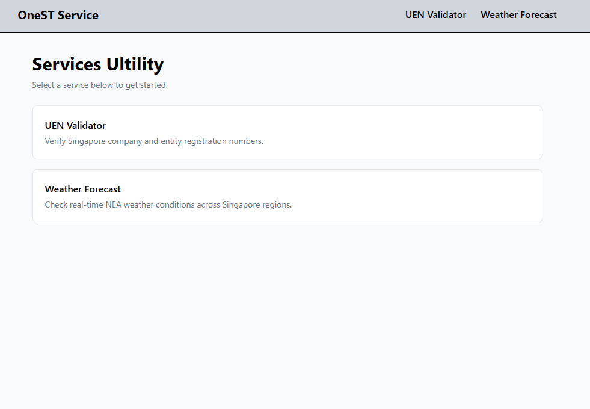
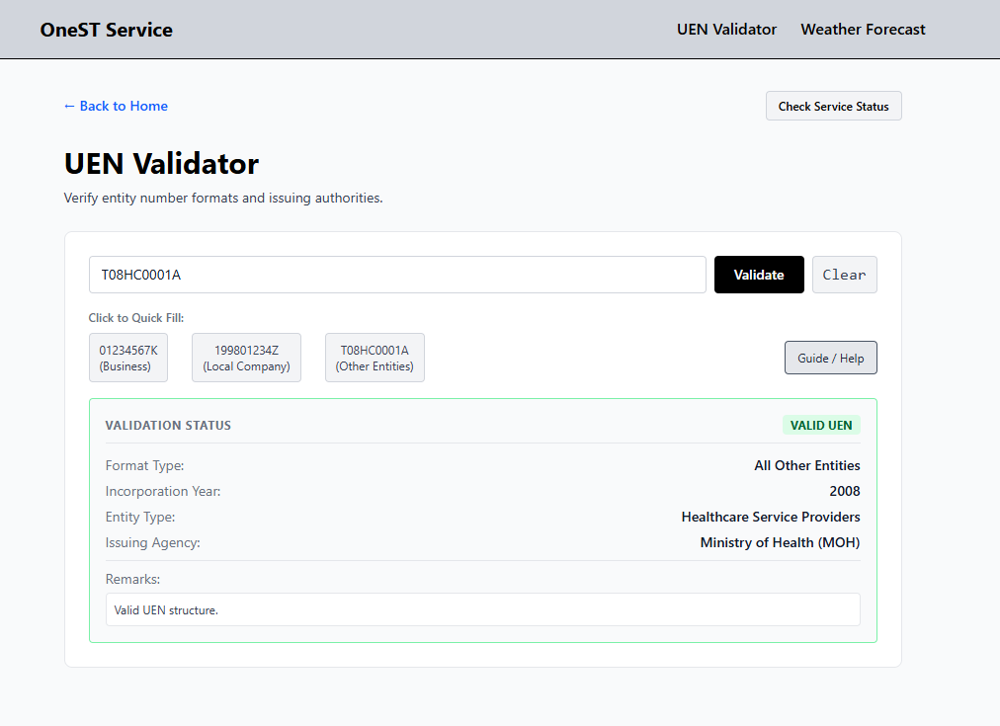
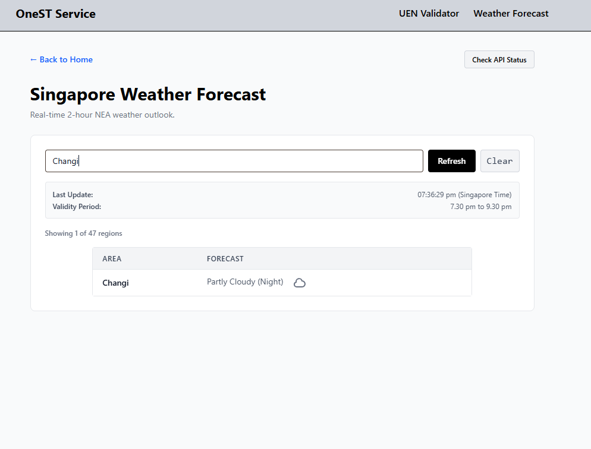
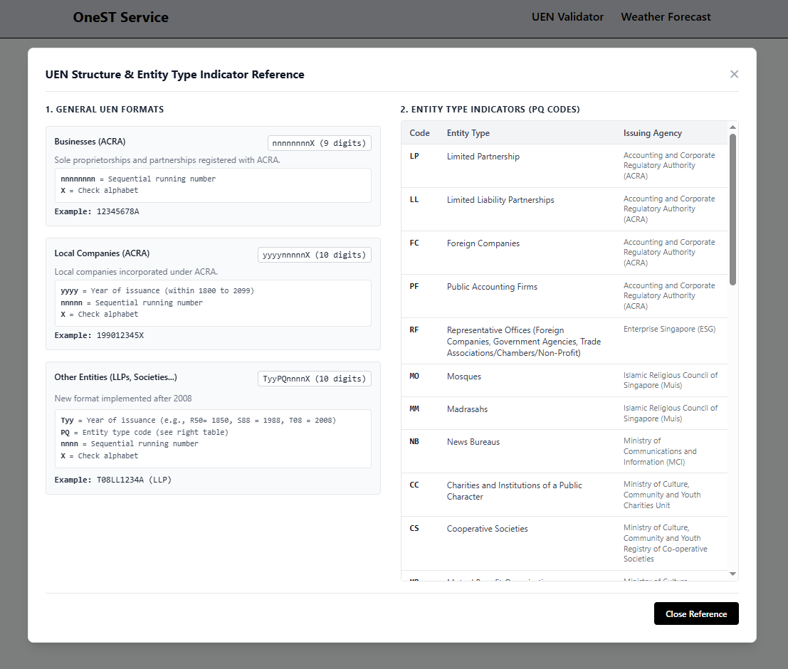
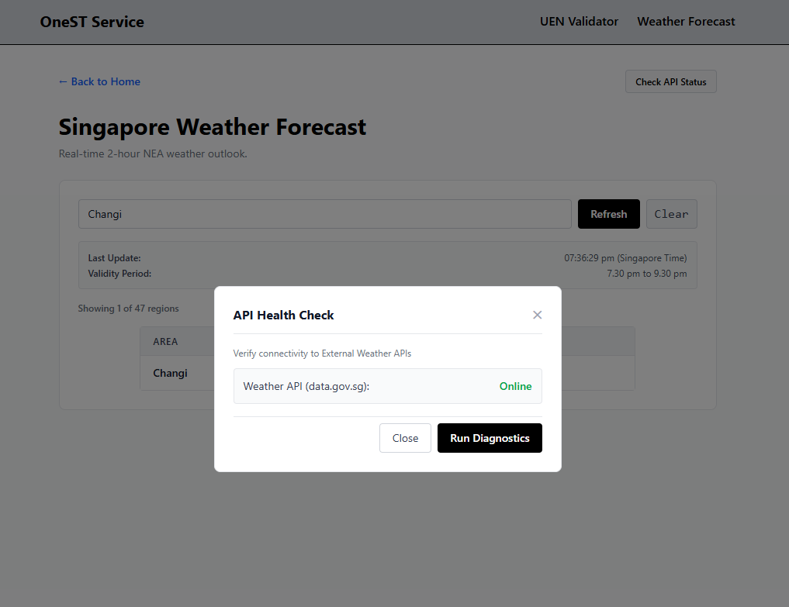
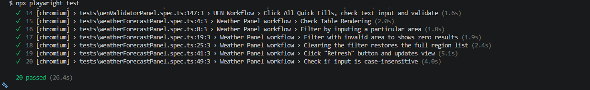
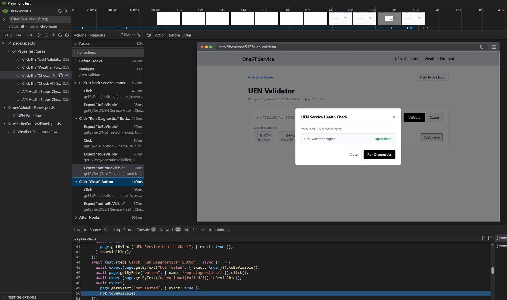

### Visual Preview

|            Home Dashboard            |           UEN Validator            |              Weather Forecast              |
| :----------------------------------: | :--------------------------------: | :----------------------------------------: |
|  |  |  |

# OneST Service Utility Portal

A modern web application that provides a unified platform for accessing various services and utilities. The portal is designed to enhance user experience by offering a seamless interface for navigating through different service offerings.


## Feature 1

### UEN Validator

A tool to verify Singapore company and entity registration numbers based on 3 formats:

- Business UEN (format: nnnnnnnnX, 9 digits)
- Local Company UEN (format: yyyynnnnnX, 10 digits)
- Other Entity UEN (format: TyyPQnnnnX, 10 digits)

Result with details are displayed as either "VALID UEN" or "INVALID UEN" based on the input provided.


Modal available for user guidance on UEN formats and validation rules.


## Feature 2

### Weather Forecast:

A feature that provides real-time NEA weather conditions across Singapore regions up to 2 hours in advance.

Search function is available to filter by region name, with case-insensitive matching and partial string support. Users can also refresh the data manually to get the latest updates.


API Health Check is implemented to ensure the service is operational, with appropriate error handling for network issues or service unavailability.



## Tech Stack

- Frontend: React.js
- Styling: Tailwind CSS
- Language: TypeScript
- Testing: Playwright
- External: External APIs for weather data

## Project Structure

```text
src/
├── assets/ # screenshots for README
├── components/ # Reusable UI components & Modals
├── data/ # Data files and API sample data
├── pages/ # Main views (UenPage, WeatherPage, HomePage)
├── services/ # API fetching and data processing
├── utils/ # Validation logic & helper functions
├── types/ # TypeScript type definitions
├── App.tsx # Application routing and layout wrapper
└── main.tsx # Application entry point
tests/
├── pages.spec.ts # Navigation & API routing E2E tests
├── uenValidatorPanel.spec.ts # UEN validation & workflow E2E tests
└── weatherForecastPanel.spec.ts # Weather table & filtering E2E tests
```

## Installation

1. Go to https://github.com/lklim050/onest-services and download the source code.

OR at your terminal, run the following commands:

```bash
git clone https://github.com/lklim050/onest-services.git
cd onest-services
```

2. Install dependencies:

```bash
npm install
```

3. Start the development server:

```bash
npm run dev
```

## Run Tests with Playwright

This project features a comprehensive End-to-End (E2E) testing suite built with **Playwright and TypeScript**, covering user workflows, network mocking, and edge-case handling across 3 core modules.

### Test Coverage Breakdown (20 Tests)

1. **Navigation & Core Flow (`pages.spec.ts`)**:
   - Validates multi-page routing between Home, UEN Validator, and Weather Forecast.
   - Tests system diagnostics and API health status rendering.
   - **Network Interception:** Simulates online/offline states and `503` service unavailable scenarios using `page.route()`.

2. **UEN Validator Workflow (`uenValidatorPanel.spec.ts`)**:
   - Covers all UEN formats (Business, Local Company, Other Entity) with expected results (`VALID UEN`).
   - Validates edge-case such as empty input and short/invalid length rejection handling (`INVALID UEN`).
   - Tests power-user interactions: keyboard `Enter` submission, Quick-Fill buttons, input clearing, and modal lifecycle management (Guide/Help reference).

3. **Weather Forecast Workflow (`weatherForecastPanel.spec.ts`)**:
   - Verifies Weather table rendering and real-time data attributes.
   - Tests partial-string filtering, case-insensitivity, and zero-result handling, and filter clearing to restore full region lists.
   - Validates manual refresh actions.

4. At your terminal, execute the following command to run all tests:

```bash
npx playwright test
```



OR in UI mode, run:

```bash
npx playwright test --ui

```


